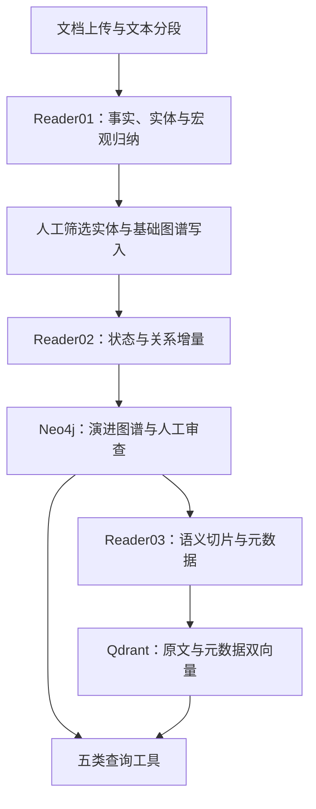

# Graph-Vector Hybrid RAG Engine

**面向长文本的结构化解析、实体状态演进与图谱／向量混合检索框架**

基于 **LangGraph、Neo4j、Qdrant 和 Streamlit**，将分散在长文本不同位置的事实、实体状态、关系变化与原文证据，组织为可追踪、可审查、可检索的数据结构，为后续 RAG 与分析 Agent 提供数据基础。

本项目由作者自行开发的一个面向特定文本的解析工具抽象演化而来。原工具需要在分段处理的条件下，持续维护实体的历史信息与关系网络，并在需要时回到原文核对细节。在此基础上，项目将实体分类、属性维度、关系规则、宏观归纳任务和切片元数据抽离到配置中，保留解析、演进、审查与检索之间的协作机制，形成可供不同任务复用的处理框架。

**当前实现范围：** Reader01／02／03、人工审查界面、Neo4j／Qdrant 读写和五类查询工具均已实现。Analyzer 提供基础对话与扩展入口，尚未接入自动工具调用和完整的检索问答流程。

## 长文本解析中的业务复杂性

长文本分析需要同时回答多个层次的问题：某个实体经历了什么、某一阶段的状态是什么、关系何时发生变化，以及这些判断分别依据哪段原文。信息分散在不同段落中，后文又可能补充或改变前文信息，因此“召回相关片段”只是处理链路的一部分。

例如，一份项目记录先后记载负责人从 A 变为 B、某项交付由计划转为延期。同一关键词可能召回这些不同阶段的描述；如果缺少位置与状态边界，就容易把曾经成立的事实当成当前事实。与此同时，概括为“项目发生延期”又会丢失具体经过，难以支持后续核查。

| 业务难点 | 对处理系统的要求 | 本项目的设计回应 |
| --- | --- | --- |
| 实体信息分散，状态与关系持续变化 | 保留历史，并区分各阶段的信息 | 实体与 State 分离，以增量更新和段落锚点组织状态链 |
| 宏观总结与局部证据需要不同粒度 | 既能归纳整体，又能回到具体描述 | Macro／Segment 分层归纳，配合保留原文的语义切片 |
| 少数实体需要深度追踪，大量实体仅偶尔出现 | 在追踪细度与图谱规模之间分配资源 | 主要实体维护状态，次要实体以带摘要的出现关系保存轨迹 |
| 分段处理后仍需维持上下文 | 为新段落提供相关历史，而非每次重读全部文本 | 前段摘要、当前活跃实体及其最新状态／关系共同参与解析 |
| 任务更换时，实体和指标定义随之变化 | 让业务语义可调整，并保持上下游字段对齐 | 配置驱动输出 Schema、提示词、写库属性、向量配方和工具参数 |

### 图谱与向量库的协作

**Neo4j 保存结构与演进：** 文本层级、实体出现位置、属性快照、状态起止位置及关系变化，便于沿文本顺序查询。

**Qdrant 保存原文与细节：** 带上下文的语义切片、实体和自定义元数据，便于回到原文核对具体描述。

**查询工具提供组合使用的接口：** 图谱查询得到的段落范围和实体线索，可以成为向量检索的过滤条件；后续应用可先定位状态变化，再查找对应文本证据。

这套设计将信息提取、历史维护与证据检索放在同一条数据链路中。其价值在于让下游分析能够区分“发生过什么”“某阶段是什么状态”和“原文如何描述”；具体效果仍需结合任务、配置与模型验证。

## 核心设计

### 配置驱动的动态 Schema

`system_schema_config.json` 定义核心业务语义：提取什么实体、追踪什么属性、识别什么关系、归纳什么内容，以及给切片附加哪些元数据。

配置参与多个环节：

| 环节 | 配置如何生效 |
| --- | --- |
| 结构化输出 | 动态生成各 Reader 与宏观归纳任务的 Pydantic 模型 |
| 提示词 | 将实体定义、字段描述和提取要求渲染进对应模板 |
| 图谱写入 | 根据实体类别和输出字段组装节点标签、属性及关系更新 |
| 向量化 | 按配方组合实体和自定义元数据，生成 `meta_vector` |
| 工具参数 | 将可查询属性注入工具的参数 Schema，约束字段选择 |

引擎保留固定的排序主键和基础拓扑，业务实体分类与属性通过配置扩展。这样，字段定义的调整可以沿解析、存储和查询链路传递，减少各模块分别维护业务字段所带来的不一致。模型路由、运行路径和部分处理参数另由 Python 配置文件管理。

### 将提取、演进与切片分开处理

Reader01 负责事实与实体提取，Reader02 负责状态及关系增量，Reader03 负责语义切片与向量化。各阶段共享分段文本、实体名单和结构化账本，也可通过独立入口运行。

不同任务由不同节点处理，使事实提取、增量判断和切分定位可以分别定义输出约束、选择模型和检查结果。Reader02 只对当前段涉及的主要实体读取历史信息，将历史上下文集中在当前任务相关的对象上。

LangGraph 管理节点、条件路由和阶段间暂停；SQLite 检查点记录工作流状态，用于断点恢复。JSON／JSONL 账本保留中间结果，方便检查各阶段的输入与输出。

### 以状态快照保存演进

实体节点保存名称与来源标识，随文本推进变化的属性放在独立的 `State` 节点中。更新时继承原有属性、覆写变化字段，并连接前后快照，保留历史信息。

关系从某一阶段的 State 指向目标实体，因此能随发起方的状态定位。新快照创建时，程序先继承原有关系，再应用本段增量，使属性更新和关系延续能够共同维护，而不必在每段重新生成完整关系网。

这里的“时序”首先指文本段落的推进顺序。是否对应现实中的时间顺序，需要由输入文本与任务规则保证。

### 按追踪需要分配存储与处理成本

主要实体维护属性快照和关系演进，次要实体保存出现位置与摘要；宏观属性按任务选择原料字段聚合，原文细节则保留在切片中。这使不同信息获得不同的处理粒度，避免所有实体、所有段落都采用同样昂贵的表示方式。

### 由模型判断语义，由程序维护结构

模型负责提取事实、识别变化和建议语义断点；Pydantic 约束字段与类型，程序负责状态复制、关系继承、位置连接和切片边界校验。下游通过预定义工具访问数据库，并按配置选择字段，使语义判断与数据操作各有明确职责。

### 将人工审查纳入流水线

Streamlit 提供实体筛选、主要／次要实体分流、状态与关系修正，以及语义切片断点检查。审查入口放在分类、演进和切分这些影响后续处理的环节，使用户有机会在继续处理前发现并修正偏差。Pydantic 约束输出结构，人工审查用于检查具体内容与分类是否符合任务要求。

## 解析流程



### Reader01：事实提取、宏观归纳与实体清洗

**文档输入与分段。** 支持上传 TXT、DOCX、PDF、EPUB，转换为纯文本后，按配置的正则表达式识别标题和段落边界。文件解析包含编码探测、PDF 文本换行整理、EPUB 标签剥离及空白规整。

**逐段提取。** `reader01_node` 携带上一段事实摘要，提取当前段的 `segment_summary`、实体名单与自定义字段，为跨段理解提供上下文。提取结果通过动态 Pydantic 模型校验后写入账本。

**按原料归纳宏观属性。** `reader01_macro_summarizer_node` 按配置的段落范围，从 Reader01 账本收集指定字段，例如摘要或专项摘录，再生成对应的 Macro 属性。不同归纳任务可以使用不同原料字段，避免所有任务都依赖同一份通用摘要。

**主要／次要实体分流。** 用户根据实体频次和人工判断确定哪些实体需要深入追踪：

| 分类 | 存储与处理方式 |
| --- | --- |
| 主要实体 | 建立实体节点，由 Reader02 追踪属性与关系演进 |
| 次要实体 | 建立实体节点，通过带摘要的 `APPEARED_IN` 关系记录出现位置，不逐段创建 State |
| 剔除实体 | 不写入后续实体图谱；原始文本和中间提取账本仍可能包含相关名称 |

次要实体策略在保留出现轨迹的同时，减少逐段状态节点的创建。审核完成后，Reader01 写库脚本建立 Macro／Segment 骨架，写入段落属性、宏观属性、实体和出现记录。

### Reader02：实体状态与关系演进

`reader02_state_evaluator_node` 和 `reader02_relation_evaluator_node` 分别处理状态与关系。它们只针对当前段涉及的主要实体，读取 Neo4j 中的最新状态及相关关系，与当前原文进行比较。

提示词要求模型仅输出首次出现或发生实质变化的属性，未变化字段置为 `null`。写库服务 `Reader02GraphService` 据此执行：

1. **收集有效增量。** 整理发生属性变化或发起有效关系更新的实体。
2. **创建新快照。** 通过 `coalesce(properties(old_s), {})` 继承旧属性，再合并有效增量。
3. **连接状态边界。** 新状态以 `START_AT` 锚定当前 Segment；旧状态以 `NEXT` 指向新状态，并以 `END_AT` 记录结束位置。
4. **继承并更新关系。** 将旧状态的 `RELATION` 边复制到新状态，再合并当前关系变化。

Streamlit 提供实体状态变化和双向关系时间线视图。用户可修改字段，并批量更新对应实体／方向下属性匹配的状态节点或关系边。

### Reader03：语义切片与双向量检索

**确定语义断点。** `reader03_chunking_node` 将输入段落标为 `[1]...[N]`，按文本长度计算切片数量范围，由模型返回切片起始段号和元数据。程序校验首个起点为 1、切点递增、边界有效及单块长度比例，不通过时携带错误反馈重试。

**保留边界上下文。** 逻辑切片确定后，按配置比例向前后扩展自然段，生成 `physical_range` 与实际原文。当前默认比例为 15%，每侧至少尝试扩展一个自然段，并受文本边界限制。界面提供整体切片分布图与相邻切片的上下文对照。

**分别表达内容和元数据。**

- `text_vector`：对扩展后的原文生成 Embedding，用于原文语义检索。
- `meta_vector`：按 `meta_vector_components` 组合实体和自定义字段后生成 Embedding。
- 检索时分别召回两路候选，使用 RRF（倒数排名融合）合并排序，并支持段落范围、实体和来源标识过滤。

切片使用 `segment_id * 10000 + chunk_index` 生成 Point ID；相同标识的再次 upsert 会覆写对应 Point。当前 ID 方案面向单份文本，跨文档使用时需要另行设计命名空间或标识规则。

## 查询工具与 Analyzer 扩展

`app/agents/tools.py` 提供五类工具，可由下游 Agent 或其他应用调用：

| 工具 | 查询内容 | 主要能力 |
| --- | --- | --- |
| `query_macro_and_segment_context` | Macro／Segment 信息及区间内实体汇总 | 层级切换、起止 ID、来源过滤、动态属性选择、结果切片 |
| `query_entity_state_evolution` | 主要实体的状态快照及起止段落 | 实体类型、段落区间、各实体类型的属性枚举、相邻相同属性折叠 |
| `query_entity_relation_evolution` | 实体间的有向关系演进 | 起终点名称／类型、段落区间、关系属性选择、连续相同结果合并 |
| `query_minor_entity_appearances` | 次要实体的出现位置与摘要 | 段落范围、按序返回、结果切片 |
| `probe_qdrant_semantic_chunks` | 双向量融合检索的切片及元数据 | 段落范围、实体 MatchAny 过滤、来源过滤、top_k、返回字段选择 |

图谱工具支持的起止 ID 可使用负数表达倒数位置，`result_slice` 使用 Python 风格的结果切片语法。工具参数中的业务属性由配置生成枚举，用于约束可请求的字段。

Analyzer 已接入工作流和基础对话界面。目前的 `analyzer_node` 调用模型生成基础回复；开发者可在这里接入工具调用、检索结果组织和领域分析逻辑。

## 存储结构

### Neo4j

| 节点类型 | 内容 |
| --- | --- |
| `Macro` | 宏观文本分组：`macro_id`、`macro_name`、`type` 与归纳属性 |
| `Segment` | 有序文本段落：`segment_id`、`segment_name`、`segment_summary`、`type` 与附加属性 |
| 配置中的 `<EntityClass>` | 自定义类别的实体：`name` 与 `type` |
| `State` | 主要实体的属性快照，字段由 `state_properties` 定义 |

| 关系 | 连接方式与用途 |
| --- | --- |
| `CONTAINS` | Macro → Segment，表示包含关系 |
| `NEXT` | 连接前后 Macro、Segment 或 State，保存顺序 |
| `DEBUTED_IN` | 实体 → Segment，记录首次出现位置 |
| `APPEARED_IN` | 次要实体 → Segment，附带该段摘要 |
| `HAS_STATE` | 主要实体 → State，关联属性快照 |
| `START_AT`／`END_AT` | State → Segment，标记快照的起止位置 |
| `RELATION` | 发起实体的 State → 目标实体，保存该阶段的关系属性 |

### Qdrant

默认集合为 `reader03_semantic_chunks`，使用 Cosine 距离与两组命名向量，当前默认维度均为 1536。

Payload 包括 `segment_id`、`segment_name`、`chunk_index`、`entities`、`type`、`text` 及自定义字段。集合初始化时为 `segment_id` 建立 INTEGER 索引，为 `entities` 与 `type` 建立 KEYWORD 索引。

原文保存在 `text` 中，向量化不会移除原文。

## 配置与场景适配

核心配置位于 `system_schema_config.json`，详细字段说明见 [system_schema_config_comment.md](system_schema_config_comment.md)。

| 配置块 | 控制内容 |
| --- | --- |
| `macro_nodes` | 宏观分组范围、归纳目标和原料字段映射 |
| `segment_nodes` | 分段正则、名称清洗规则、段落提取属性 |
| `entity_system` | 实体类别、类别定义与状态属性 |
| `relationships` | 关系组、允许的起终点类别与关系属性 |
| `vector_system` | 切片元数据与元数据向量配方 |

以下是不同任务的配置方向，不代表已经完成相应领域的效果验证：

| 场景 | Macro／Segment | 实体分类示例 | 状态与关系示例 |
| --- | --- | --- | --- |
| 业务报告 | 财年／报告章节 | Company、Product、Executive | 经营状态、风险变化、业务依赖、控股关系 |
| 历史记录 | 历史阶段／编年事件 | HistoricalFigure、Organization、Event | 职位变化、立场变化、联盟与隶属关系 |
| 项目记录 | 项目阶段／阶段记录 | Team、Project、Deliverable | 项目状态、责任关系、交付变化 |
| 叙事文本 | 分卷／章节 | Character、Faction、Item | 身份、属性、关系倾向与物品归属 |

适配时需要同时考虑文本切分、实体定义、字段说明、宏观原料选择和提示词；结构差异较大的任务可能需要调整代码。

## 快速开始

### 1. 准备 Python 环境

需要 Python 3.11+。在仓库根目录创建虚拟环境：

```bash
python -m venv .venv
```

Linux／macOS／WSL 的 Bash：

```bash
source .venv/bin/activate
```

Windows PowerShell：

```powershell
.\.venv\Scripts\Activate.ps1
```

激活后安装依赖：

```bash
python -m pip install -r requirements.txt
```

### 2. 准备 Neo4j 与 Qdrant

可连接已有数据库，也可通过 Docker 启动本地实例。下面是 Bash／WSL 下的本地开发示例，使用 Docker 命名卷保存数据；请替换示例密码与密钥。

```bash
docker run -d \
  --name hybrid_rag_neo4j \
  -p 127.0.0.1:7474:7474 \
  -p 127.0.0.1:7687:7687 \
  -v hybrid_rag_neo4j_data:/data \
  -v hybrid_rag_neo4j_logs:/logs \
  -e NEO4J_AUTH=neo4j/change_this_password \
  neo4j:latest
```

```bash
docker run -d \
  --name hybrid_rag_qdrant \
  -p 127.0.0.1:6333:6333 \
  -p 127.0.0.1:6334:6334 \
  -v hybrid_rag_qdrant_data:/qdrant/storage \
  -e QDRANT__SERVICE__API_KEY=change_this_qdrant_key \
  qdrant/qdrant:latest
```

镜像标签是启动示例；需要复现环境时，应固定实际验证过的版本。部署参数可参考 [Neo4j Docker 文档](https://neo4j.com/docs/operations-manual/current/docker/introduction/) 与 [Qdrant Quickstart](https://qdrant.tech/documentation/quickstart/)。

### 3. 配置连接与模型

在仓库根目录创建 `.env`，与上述本地示例对应：

```dotenv
OPENROUTER_API_KEY=your_openrouter_api_key

NEO4J_URI=bolt://localhost:7687
NEO4J_USER=neo4j
NEO4J_PASSWORD=change_this_password

QDRANT_URL=http://localhost:6333
QDRANT_API_KEY=change_this_qdrant_key
```

若使用已有数据库，请填写相应连接信息。Neo4j 需要在启动 Streamlit 前可连接。

在 `app/agents/app_agents_config.py` 中调整各阶段模型、Embedding 模型及服务商路由。当前客户端通过 LiteLLM 接入 OpenRouter，并使用 OpenRouter 路由参数；改接其他服务入口时，还需要检查鉴权和请求参数。

向量维度位于 `app/database/app_database_config.py` 的 `init_vector_size`，当前为 1536，必须与 Embedding 输出一致。更换 Embedding 模型时应检查已有向量集合是否需要重建。

### 4. 填写业务配置

当前 `system_schema_config.json` 包含 `EntityClassA`、`fieldA` 等占位项，不能直接作为完整的任务配置使用。可编辑 JSON，也可在 Reader01 的配置面板中填写并保存。

至少需要检查：

- **分段规则：** `split_pattern` 使用捕获组保留标题，以匹配解析器的“标题／正文”配对方式；为文本设置合适的名称清洗规则。
- **实体与属性：** 定义类别、提取要求、状态属性和需要的关系维度；字段的 `description` 会作为模型指令的一部分。
- **宏观归纳：** 使用有效的 `segment_range`，明确每项归纳任务对应的原料字段。
- **切片元数据：** 配置需要提取的字段，并确保 `meta_vector_components` 中的字段与配置一致。

### 5. 启动与运行

始终从仓库根目录执行：

```bash
python -m streamlit run main.py
```

浏览器地址以终端输出为准，默认通常为 `http://localhost:8501`。

| 顺序 | 页面 | 操作 |
| --- | --- | --- |
| 1 | Reader01 提取与清洗 | 上传文档，保存配置，执行逐段提取与宏观归纳 |
| 2 | Reader01 提取与清洗 | 审查主要／次要实体名单，保存后执行 Neo4j 图谱写入 |
| 3 | Reader02 状态与关系 | 执行增量追踪，审查状态和关系并按需修正 |
| 4 | Reader03 切片与向量化 | 执行语义切片，检查边界，再向量化写入 Qdrant |

Reader02／03 当前各有处理段数上限，配置于 `app/graph/app_graph_config.py`：

```python
reader02_router_test_segment_num = 130
reader03_router_test_segment_num = 130
```

处理更长文本时需调整。更换输入文本时，也需检查运行路径、线程标识、检查点及已有数据库数据，避免沿用上一份文本的处理状态。

### 独立脚本

完成输入、配置和前置数据准备后，可分别运行以下入口：

```bash
python reader01_run_ingestion.py
python reader01_write_neo4j.py
python reader02_run_evolution.py
python reader03_run_chunking.py
python reader03_write_qdrant.py
```

独立运行 Reader01 前需将输入转换为 UTF-8 纯文本并放到配置路径；多格式上传转换由界面提供。实体名单的人工审核仍需完成。

## 主要代码位置

| 位置 | 职责 |
| --- | --- |
| `main.py` | Streamlit 主入口与页面导航 |
| `root_running_config.py` | 业务配置加载、运行路径与任务线程配置 |
| `system_schema_config.json` | 核心业务 Schema 与解析规则 |
| `system_schema_config_comment.md` | 字段规范与配置示例 |
| `reader01_app_streamlit.py`／`reader01_run_ingestion.py`／`reader01_write_neo4j.py` | 文档上传、配置、提取清洗、实体筛选与基础图谱写入 |
| `reader02_app_streamlit.py`／`reader02_run_evolution.py` | 演进任务执行与状态／关系审查 |
| `reader03_app_streamlit.py`／`reader03_run_chunking.py`／`reader03_write_qdrant.py` | 切片审查、执行与向量化入库 |
| `analyzer_app_streamlit.py` | Analyzer 基础对话入口 |
| `app/agents/` | 模型配置、LiteLLM 客户端、提示词与查询工具 |
| `app/database/` | Neo4j／Qdrant 客户端和读写服务 |
| `app/graph/` | 状态定义、执行节点、条件路由与检查点 |
| `app/models/schemas.py` | 动态 Pydantic 模型工厂 |
| `app/utils/` | 多格式文件解析与日志 |

## 日志与中间数据

- **LLM 追踪：** `logs/llm_traces/` 中按运行时间生成 JSONL，记录模型、调用状态、原始输出、错误信息和 Token 用量；具体用量字段随调用方法及供应商返回而异。
- **系统日志：** `logs/system/` 保存按日期命名的 INFO 及以上级别日志，终端输出包含更详细的 DEBUG 信息。
- **中间账本与检查点：** `data/` 保存分段原文、提取结果、实体名单、状态／关系增量、语义切片和 SQLite 检查点，具体路径可在配置中查看。

这些文件可能包含输入文本、提取内容或模型输出。分享示例时应选择具备相应使用与传播权限的材料，并排除真实密钥与私有数据。

## 当前边界

- 多格式解析以获取可读文本为主，尚未实现扫描 PDF 的 OCR、复杂表格及原始版式结构恢复。
- 动态 Schema 约束结构与字段，不能保证抽取事实、状态判断和关系识别一定正确。
- 默认路径、线程、实体标识和 Point ID 主要面向单份文本，尚未内置完整的多文档隔离与多用户管理。
- 当前未提供跨领域效果评测、超长文本规模测试或生产部署指标；不同任务需先用小规模样本验证。

## 数据与许可

本项目提供文本处理框架，输入文档由使用者提供。文档及结果中的第三方内容不因解析、摘要或向量化而改变权利归属；使用和分享相关材料时应具备相应权限。

本项目自行开发的代码以 **GNU Affero General Public License v3.0（AGPL-3.0-only）** 发布。完整条款见 [LICENSE](LICENSE)。

Copyright (C) 2026 kafumorisaki-web

你可以按许可证条款使用、修改和分发本项目，也可以用于商业用途。分发受该许可证覆盖的软件，或通过网络提供受其远程交互条款约束的版本时，需要履行相应的源码提供、许可与版权声明义务。

第三方依赖保留各自的许可与版权声明，其中 [PyMuPDF](https://pymupdf.io/licensing) 提供 AGPL／商业双重许可，[EbookLib](https://github.com/aerkalov/ebooklib) 使用 AGPL。本项目的授权不改变第三方组件的许可条件。

本项目及开发者不支持、鼓励或认可使用本工具处理未取得必要授权且无其他合法使用依据的材料，或实施侵犯著作权、隐私权及其他合法权益的行为。使用者应对其数据来源、使用方式和相关行为负责；开发者仅开源工具的基本框架，不对使用者可能的违法、侵权或滥用行为及其造成的后果承担责任。
